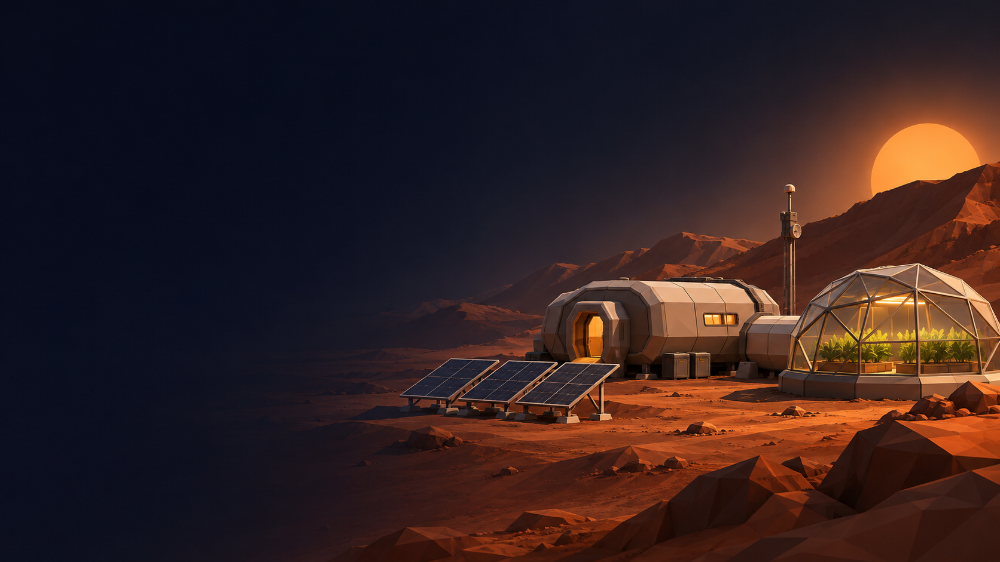

# Base Aurora — equipe Kera

Protótipo educativo em **Flutter web** para o desafio **Build a Junior Astronaut Mission Trainer**. O estudante registra uma expectativa, decide como administrar energia e cultivo em uma base marciana fictícia, observa o resultado e compara estratégias a partir do mesmo estado inicial.



## Acessar e apresentar

- [Abrir a demonstração pública](https://base-aurora-kera.florapupo.chatgpt.site)
- [PowerPoint editável](docs/apresentacao/Base_Aurora_Kera_Submissao.pptx)
- [Apresentação em PDF](docs/apresentacao/Base_Aurora_Kera_Submissao.pdf)
- [Fluxo de deploy pelo GitHub](docs/VERCEL.md)

A apresentação tem 7 slides em inglês, captura real do protótipo, comparação das estratégias e links das fontes. O PowerPoint inclui transições de dissolução.

## O que funciona

- Landing page responsiva em português, com ciência, atribuições, entrada animada e aproximação gradual da arte de fundo.
- Indicadores animados, sinalização na cena 3D e controle de pausa das animações. A preferência de movimento reduzido do navegador é respeitada.
- Cena 3D WebGL com terreno, habitat, estufa, painéis e abrigo. Câmera orbital e seleção por toque/clique. Controles Flutter também permitem selecionar módulos.
- Motor determinístico em Dart, com cinco indicadores e três estratégias.
- Registro de recurso a preservar e custo esperado, antes de revelar resultados.
- Balanço de energia verificável, comparação controlada e reflexão final.
- Exportação local do registro da missão em JSON, sem coletar identificação.
- AURA em modo local: busca lexical em sínteses científicas revisadas, explicações e links das referências recuperadas. Não usa um LLM sem configuração.
- Backend Node opcional com recuperação lexical ponderada e geração via API compatível com Chat Completions. Validação de citações, recomputação dos resultados, limite de requisições e tempo de resposta.

O 3D usa **Three.js 0.180.0**, integrado ao Flutter por `HtmlElementView` e uma página local. Flutter controla a interface e o motor; JavaScript controla apenas a visualização. Não é o pacote Dart `three_js`. Os arquivos do renderer estão no projeto, sem CDN em execução.

## Começar localmente sem chave de IA

Requer Flutter estável com Dart >= 3.8, e navegador moderno para a cena. WebGL2 oferece a renderização principal; sem ele, um renderer CPU projeta a mesma geometria 3D em Canvas 2D, com câmera orbital e seleção. Versão usada na compilação: Flutter 3.50.0 / Dart 3.14.0. Node >= 22 para o backend opcional.

```sh
git clone https://github.com/FloraRosaPupo/base-aurora.git
cd base-aurora
flutter pub get
flutter run -d chrome --web-port 3000
```

Para compilar:

```sh
flutter build web --release --output dist --no-wasm-dry-run
```

Hospede **todos** os arquivos de `dist/`, incluindo `scene.html`, `scene.js`, `vendor/`, `assets/` e os arquivos Flutter/CanvasKit. O `base href` é `/`. Alterações de subdiretório exigem ajustar também o endereço da cena. A primeira compilação e o primeiro carregamento podem precisar dos artefatos oficiais do Flutter.

## Ativar geração com RAG

O protótipo publicado usa o modo local revisado. Para ativar um modelo:

1. Copie `backend/.env.example` para `backend/.env`, que não deve entrar no Git.
2. Informe `LLM_API_KEY`, `LLM_BASE_URL` (URL base compatível) e `LLM_MODEL` do provedor disponível.
3. Configure `ALLOWED_ORIGINS` com os endereços exatos do frontend, separados por vírgula.
4. Inicie o backend:

```sh
node --env-file=backend/.env backend/server.mjs
```

5. Rode/compile Flutter com a URL completa do endpoint:

```sh
flutter run -d chrome --web-port 3000 --dart-define=AURA_API_URL=http://localhost:8787/commander/help
```

Para um frontend hospedado em HTTPS, o endpoint também precisa de HTTPS. Nunca inclua chave do modelo em `--dart-define`, no código Flutter ou no navegador.

O backend recupera documentos em `assets/knowledge.json` e envia contexto, expectativa e evidências ao modelo. Antes da decisão, não envia o resultado reservado. Depois, recalcula o resultado no servidor. Somente citações de fontes recuperadas são aceitas. O modelo não altera recursos. Em falha de rede/modelo, Flutter recorre ao modo local e o identifica.

**O que isso não comprova:** não houve ativação de provedor externo nem avaliação de qualidade generativa com chave real. Não há embeddings ou pgvector implementados nesta versão. A recuperação lexical é um recorte funcional para um corpus pequeno. A migração para busca vetorial é uma evolução posterior.

## Ciência e limitações

As fontes estão em `assets/knowledge.json`, com URLs e sínteses autorais revisadas. Não são cópias integrais dos documentos ou dados de telemetria.

- NASA, ECLSS: recuperação de água, revitalização do ar e geração de oxigênio na ISS.
- NASA, Martian Dust Storms: poeira e geração solar.
- NASA Science, VEGGIE: estudos de cultivo e complementação alimentar na ISS.
- NASA, Space Radiation: riscos da radiação para exploração humana.

O jogo usa **unidades didáticas**, períodos comprimidos e plantas estabelecidas. Exposição é um índice de jogo, não dose médica. As constantes de manutenção, produção e consumo são escolhas de balanceamento, não parâmetros certificados pela NASA. Materiais da ISS fundamentam princípios e não validam um habitat humano em Marte.

As três estratégias são viáveis no estado inicial e têm compromissos diferentes. Em uma partida com configuração de recursos diferente, o motor permite detectar falha sem esconder o déficit.

Antes da submissão, a equipe deve confirmar que pelo menos um recurso efetivamente usado pertence à lista Resources do desafio e que atende às regras vigentes. Não há confirmação de elegibilidade, cadastro da equipe ou submissão automática.

## Estrutura

- `lib/features/mission/domain/`: estado, estratégias e regras puras.
- `lib/features/base_scene/`: integração de visualização Flutter/iframe.
- `lib/features/commander/`: recuperação local e cliente do backend.
- `lib/main.dart`: landing, jornada, controles e comparação.
- `web/scene.*`, `web/vendor/`: cena 3D e renderer local.
- `assets/knowledge.json`: fontes e sínteses científicas.
- `backend/`: recuperação, geração opcional, HTTP e testes.
- `test/simulation_test.dart`: invariantes do motor.

## Testar sem consumir IA

```sh
flutter test test/simulation_test.dart
node --test backend/test/*.test.mjs
```

Testes cobrem balanço, determinismo, compromissos, estado inicial preservado, exposição, recursos insuficientes e validação de fontes/entrada do backend. Verificados nesta entrega: build web release; 8 testes Dart; 8 testes Node; landing, câmera orbital no modo 3D por CPU, expectativa, resultado, comparação, fontes da AURA e reflexão final em Chrome. O ambiente de teste não disponibilizou WebGL, então a renderização por GPU permanece sem validação visual. Isso não equivale a validação científica ou estudo de eficácia educativa.

Não coletamos nomes, e-mail ou conversas pessoais de alunos. O estado é mantido na memória da sessão e pode ser exportado pelo usuário. Ao configurar um provedor de IA, o contexto enviado ao backend pode ser processado por esse provedor; escolha e documente esse serviço antes de usar com alunos.

## Contribuir e acompanhar

- [Como contribuir](CONTRIBUTING.md) e [segurança](SECURITY.md).
- [Arquitetura](docs/ARCHITECTURE.md), [ambiente](docs/ENVIRONMENT.md) e [validação](docs/VALIDATION.md).
- [Ciência e simplificações](docs/SCIENCE.md), [roadmap](docs/ROADMAP.md) e [deploy Vercel](docs/VERCEL.md).

## Atribuições e uso de IA

Equipe Kera: Flora Rosa Pupo e Kevyn, conforme informações da equipe.

Código e textos preparados com assistência de ChatGPT/Codex. A ilustração da landing foi gerada com OpenAI image generation e aparece como arte conceitual. Não é uma imagem de missão real. Os modelos 3D são geometrias criadas em código. Sem uso de logos, bandeiras ou identificadores de missão NASA.

Three.js: licença MIT, incluída em `web/vendor/THREE-LICENSE.txt`. Flutter: projeto de código aberto. Fontes Manrope e Space Grotesk: licenças OFL em `assets/fonts/`. DejaVu Sans inclui licença em `assets/FONT-LICENSE.txt`. O código do projeto está sob [MIT](LICENSE). Dependências e materiais de terceiros mantêm suas próprias licenças.

Referências públicas:
- https://www.spaceappschallenge.org/2026/challenges/junior-astronaut-mission-trainer/
- https://www.nasa.gov/reference/environmental-control-and-life-support-systems-eclss/
- https://www.nasa.gov/solar-system/the-fact-and-fiction-of-martian-dust-storms/
- https://science.nasa.gov/mission/veggie/
- https://www.nasa.gov/hrp/hazard-space-radiation/

## Autores

| Integrante | Equipe |
| --- | --- |
| [Flora Rosa Pupo](https://github.com/FloraRosaPupo) | Kera |
| Kevyn | Kera |
